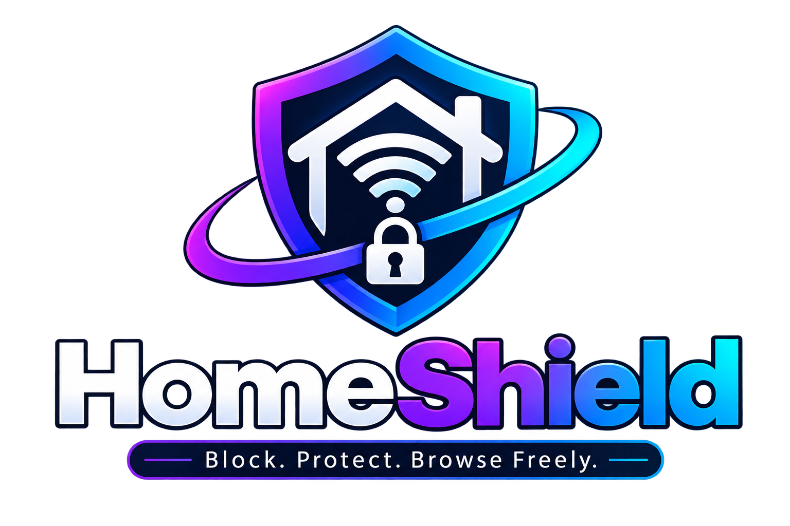
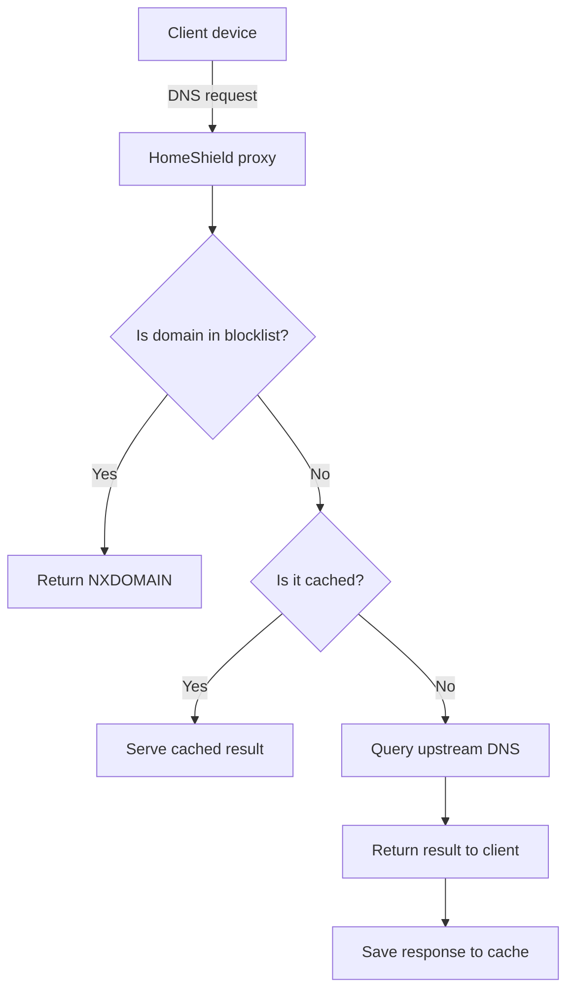
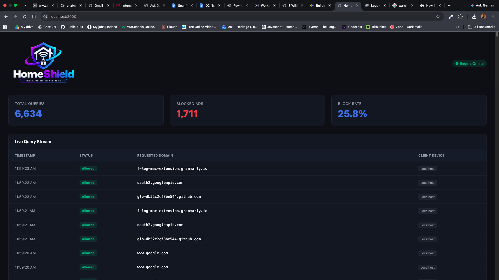

# HomeShield

<div align="center">
  
</div>

HomeShield is a lightweight, self-hosted DNS sinkhole and privacy proxy built with Node.js. It sits between your devices and upstream DNS providers and blocks ads, trackers, malware, and other unwanted domains before they reach your network.

- Built for home networks and small labs
- Protects all devices connected to the same router or network
- Runs locally with no browser extension required
- Uses a blocklist and DNS filtering to stop tracking at the source

## Overview

HomeShield acts as a local DNS filtering layer. When a device asks for a domain, the proxy checks whether that domain is in the blocklist. If it is, HomeShield replies with an NXDOMAIN response so the device cannot load the blocked site or tracker. If not, it forwards the query to an upstream DNS provider such as Google, Cloudflare, or Quad9 and can cache the response for faster future lookups.

This means HomeShield can block unwanted traffic before it even reaches your browser, app, or IoT device.

## What HomeShield does

HomeShield is designed to do all of the following:

- Block ads, trackers, and suspicious domains at the DNS layer
- Protect every device on the local network without installing per-device software
- Forward allowed queries to upstream DNS servers
- Cache responses in memory to reduce latency and repeated lookups
- Identify devices by local IP address using friendly names
- Log total queries, blocked queries, and device activity
- Expose a simple dashboard for monitoring live traffic and blocked domains
- Work as a home-network security layer for privacy and content filtering

## How it works



The proxy listens on port 53, checks each request against the local blocklist, and only forwards valid requests upstream. This allows blocking to happen quickly and consistently across the whole network.

## Features

- Network-wide ad and tracker blocking
- DNS-level sinkhole responses with NXDOMAIN
- Subdomain-aware block matching
- In-memory DNS caching
- Friendly local device names for network traffic logs
- Live query tracking and recent activity logs
- Local dashboard for stats and blocked requests
- Configurable upstream DNS settings

## Dashboard preview



## Project structure

```text
HomeShield/
├── .env.example             # Example environment configuration
├── .env                     # Local runtime environment values
├── LICENSE                  # Project license
├── README.md                # Project documentation
├── blocklist.txt            # Blocked domains, one per line
├── package.json             # Node.js scripts and dependencies
├── public/
│   ├── homeshield_logo.png  # Project logo
│   └── index.html          # Local dashboard UI
├── src/
│   ├── proxy.js            # Core DNS filtering proxy
│   ├── server.js           # Example DNS listener/server script
│   ├── dns-client-test.js  # Local DNS test client
│   ├── upstream-test.js    # Upstream DNS validation script
│   ├── api/
│   │   └── server.js       # API for stats and dashboard data
│   ├── config/
│   │   └── devices.js      # Friendly device mapping by IP
│   └── services/
│       └── tracker.js      # Query logging and stats tracking
└── node_modules/           # Installed dependencies
```

## Requirements

- Node.js 18 or newer
- Access to port 53 on the machine running HomeShield
- Administrator or root access if using the default DNS port
- A router or device configuration that points DNS requests to the HomeShield host.

## How to run

### 1. Clone the project

```bash
git clone <your-repository-url>
cd HomeShield
```

### 2. Install dependencies 

```bash
npm install
```

### 3. Configure environment

Copy the example file and adjust the values if needed:

```bash
cp .env.example .env
```

Example configuration:

```env
PORT=53
UPSTREAM_DNS=8.8.8.8
UPSTREAM_PORT=53
```

### 4. Start the proxy

On Windows, run as Administrator:

```bash
node src/proxy.js
```

On macOS or Linux:

```bash
sudo node src/proxy.js
```

The server will start listening on port 53 and begin filtering incoming DNS requests.

### 5. Open the dashboard

HomeShield serves a local dashboard on:

```text
http://localhost:3000
```

This page shows overall query counts, blocked counts, and recent request activity.

## Testing

You can verify the system using the built-in scripts:

```bash
npm run test:upstream
npm run test:client
```

The upstream test checks connectivity to the configured upstream resolver. The client test sends a DNS query through the local resolver to confirm basic operation.

You can also test directly with `nslookup`:

```bash
nslookup google.com 127.0.0.1
nslookup ads.example.com 127.0.0.1
```

A blocked domain should return an NXDOMAIN-style failure or no valid answer, while an allowed domain should resolve normally.

## Deployment and network setup guide

> **⚠️⚠️⚠️ WARNING: DNS is the phonebook of the internet. If the machine running proxy.js goes offline, enters sleep mode, or the Node.js process stops, any device configured to use it as a DNS server will instantly lose internet access.**
>
> **To restore internet access if the server goes down, either restart proxy.js or change the devices' DNS settings back to Automatic (DHCP).**

HomeShield can be deployed in several ways depending on your hardware and how you want to manage your network. Choose the method that best fits your environment.

### Method 1: Local personal computer

Best for solo developers, testing, or blocking ads on specific personal devices.

This method runs HomeShield in the background of your daily workstation using PM2.

#### Step 1: Assign a static IP to your host machine

1. Open your home router admin panel. This is usually something like 192.168.1.1 or 192.168.8.1.
2. Navigate to DHCP, LAN, or Static IP / MAC Binding settings.
3. Find your computer's Wi-Fi or Ethernet MAC address and assign it a permanent local IP such as 192.168.8.196.
4. Save the configuration and restart your computer's Wi-Fi to apply the new IP.

#### Step 2: Start HomeShield in the background

Make sure Node.js and PM2 are installed globally:

```bash
npm install -g pm2
```

Then start the project:

```bash
cd /path/to/HomeShield
npm install
pm2 start src/proxy.js --name HomeShield
pm2 save
```

This keeps the DNS proxy running in the background and allows it to restart automatically when the machine boots.

#### Step 3: Point your devices to HomeShield

On the host machine:

1. Open your network settings.
2. Edit the IPv4 configuration.
3. Set DNS to Manual.
4. Enter 127.0.0.1 as the DNS server.
5. Make sure DNS over HTTPS is disabled in your operating system settings.

On other devices:

1. Open the Wi-Fi settings for the device.
2. Choose the network and edit the settings.
3. Change IP/DNS settings from DHCP to Manual.
4. Enter your host computer's static IP, such as 192.168.8.196, as the Primary DNS.

This ensures that all DNS requests from the device pass through HomeShield before reaching the internet.

### Method 2: Dedicated Raspberry Pi

Best for whole-home ad-blocking. A Raspberry Pi acts as an always-on low-power server, which reduces the risk of losing internet access when a laptop or desktop goes to sleep.

#### Step 1: Prepare the Raspberry Pi

1. Flash Raspberry Pi OS Lite onto a microSD card using Raspberry Pi Imager.
2. Connect the Pi to your router with Ethernet for the lowest latency.
3. SSH into the Pi or open the terminal.
4. Assign the Pi a static IP through your router admin panel.

#### Step 2: Install Node.js and HomeShield

```bash
sudo apt update && sudo apt upgrade -y
curl -fsSL https://deb.nodesource.com/setup_20.x | sudo -E bash -
sudo apt install -y nodejs

git clone https://github.com/yourusername/HomeShield.git
cd HomeShield
npm install

sudo npm install -g pm2
sudo pm2 start src/proxy.js --name HomeShield
sudo pm2 startup systemd
sudo pm2 save
```

#### Step 3: Configure network-wide DNS

Instead of configuring each device manually, force your router to use the Pi for DNS.

1. Log in to your router admin panel.
2. Find the DHCP server settings.
3. Change the Primary DNS Server from your ISP default to your Raspberry Pi's static IP.
4. Save the changes and reboot the router.

Now every device that connects to your Wi-Fi will automatically use HomeShield for DNS filtering.

### Method 3: Docker container

Best for users running Unraid, Proxmox, Synology NAS, or another dedicated Linux home server.

If you prefer containerized environments, you can run HomeShield in Docker instead of installing dependencies directly on the host machine.

#### Step 1: Create a Dockerfile

Add a Dockerfile to the root of the HomeShield project:

```dockerfile
FROM node:20-alpine
WORKDIR /app
COPY package*.json ./
RUN npm install --production
COPY . .
EXPOSE 53/udp
EXPOSE 3000/tcp
CMD ["node", "src/proxy.js"]
```

#### Step 2: Build and run the container

```bash
docker build -t homeshield .

docker run -d \
  --name homeshield-server \
  --restart unless-stopped \
  -p 53:53/udp \
  -p 3000:3000/tcp \
  homeshield
```

The `-p 53:53/udp` flag is important because DNS traffic uses UDP.

#### Step 3: Route traffic

Set your router's DHCP DNS settings to the IP address of the machine hosting the Docker container. Then open the dashboard in a browser at:

```text
http://localhost:3000
```

### Recommended setup

For most home users, the best setup is:

- a Raspberry Pi or always-on mini PC as the DNS host
- a static local IP assignment for that device
- router-level DNS configuration so all devices benefit automatically

This gives you the strongest protection and avoids the downside of a laptop going to sleep or disconnecting from the network.

## Configuration

### Device names

The file [src/config/devices.js](src/config/devices.js) maps IP addresses to friendly labels so logs are easier to read.

Example:

```javascript
module.exports = {
  "192.168.8.198": "My Laptop",
  "192.168.8.199": "My Phone",
  "127.0.0.1": "Localhost"
};
```

### Blocklist management

The file [blocklist.txt](blocklist.txt) contains one blocked domain per line. You can add your own domains or replace it with another curated source.

Common blocklist sources include:

- Firebog
- StevenBlack Unified Hosts
- AdGuard DNS filter lists

## Troubleshooting

### Port 53 already in use

Another service may already be listening on port 53. If that happens, stop the conflicting service or move HomeShield to another port in your environment.

### Permission denied

Port 53 is a privileged port. Use administrator permissions or run the process with sudo.

### DNS changes not taking effect

Your OS or browser may still have cached DNS data. Flush the local DNS cache and retry.

## License

This project is licensed under the ISC License. See [LICENSE](LICENSE) for details.

